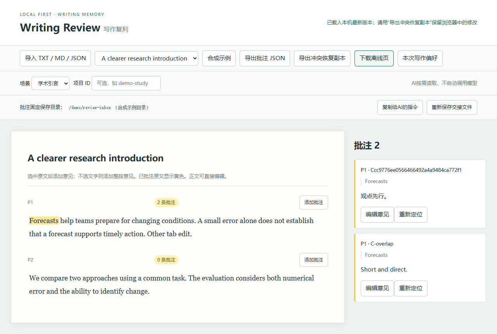

# Writing Review · 写作复利

**Write a comment. Approve a plan. Continue with the next draft.**

A local manuscript review tool with scoped Obsidian writing memory. The main page
has two actions: **open a manuscript** and **ask AI for a revision plan**. Every saved
comment goes to your fixed folder. Your chosen assistant proposes changes first;
after you approve in chat, it revises the draft, records writing preferences and
creates the next review round. The page does not secretly call a model.

[中文说明](README.zh-CN.md) · [Architecture and API](docs/architecture.md) · [Verification](docs/verification.md) · [Security](SECURITY.md) · [MIT](LICENSE)

[Contributing](CONTRIBUTING.md) · [Changelog](CHANGELOG.md) · [Synthetic sample](examples/sample.md)



## Start

Python 3.10+; no third-party runtime dependencies.

```sh
git clone https://github.com/Elio-SiChien/writing-review.git
cd writing-review
python -X utf8 -m writing_review --vault "/path/to/your/vault"
```

Windows users can double-click `start.cmd` after the first configuration. The browser
opens `http://127.0.0.1:8765`. Without a vault, reviews still save to a private local folder.
To choose another handoff location, use `--review-dir "/path/to/review-inbox"`.

## Review in three steps

1. Click **打开文稿** to open TXT, Markdown as plain text, or an existing JSON backup.
   Select the writing scene. Project identity is inherited or generated automatically.
2. Select a sentence and click **添加批注**. No selection means a paragraph comment.
   Saved comments highlight the passage in yellow; the newest comment appears first.
   Editing an older comment retains its creation time and shows an edited marker.
3. Click **请AI出修改方案**, then paste the copied instruction into your AI chat.
   It asks for a plan and source-ID mapping before any manuscript or active-preference
   changes. Approve the plan in chat; your assistant can then apply it and create the
   next round through the local API. The button copies instructions, rather than
   invoking an AI or verifying approval itself.

The page follows the next round automatically when there are no unsent changes or
open comment drafts. Completed comments stay with the archived round; unresolved
ones can carry forward. Older rounds are read-only in the current interface.
Saving versions and manuscript rounds are separate: frequent autosaves do not
create new drafts. Your assistant must check the approved source version again.

## Saving and recovery

Clicking **保存批注** immediately writes the database and configured handoff folder.
A completed write displays **已保存到Obsidian** when that folder is inside the vault,
or **已保存到本机** otherwise. A temporary folder failure
keeps the database copy and retries locally. Unsent text and comment drafts have
browser recovery. A newer approved round cannot silently erase a stale tab's edits.
Open **保存位置与备份** for the folder path and a portable backup. Recovery and retry
actions appear only when needed. Existing offline pages and legacy JSON remain supported;
a pure offline page requires downloading its backup instead of automatic folder writes.

With a vault, files default to `写作复利/批注收件箱/`. Otherwise they live in the
private data directory's `reviews/` folder:

```text
review-inbox/
  AI读取说明.md
  review-ID/
    CURRENT.json
    ROUND.json
    latest.json
    latest.md
    history/v000001.json
    history/v000001.md
```

AI readers follow `CURRENT.json` to a complete version pair. `ROUND.json` records the
stable manuscript identity and round relationship. Old version files are preserved.
Restarting the service exports existing reviews without changing their saved contents.
Assistants without local file access need you to attach the backup or relevant files.

## Writing memory and approval

Use the vault's `写作复利` quick reference and matching scene/project rules before
writing. After approval and revision, retain explicit preferences, sources and examples;
keep inferences as candidates and preserve human prose and conflicts. A project-specific
wording preference must not become a global rule. Existing scoped notes can also be read:

```sh
python -X utf8 -m writing_review --profile academic introduction project:your-project
```

This read command does not call a model. Other AI products need their own reading
instruction; they do not automatically load this vault.

Background inference remains off by default. The optional `--auto-extract` adapter
requires an authenticated compatible Codex CLI and only prepares a private proposal;
it does not activate preferences. `--codex-model YOUR_MODEL` selects an explicitly
chosen model for that optional mode. Its relevant editorial data is sent to your
configured provider. There is no model training. Restart to change startup settings.

## Tests and limits

```sh
python -X utf8 -m unittest discover -s tests -v
```

Browser acceptance needs `pip install playwright` and `playwright install chromium`,
or set `WR_BROWSER` to an installed Chromium browser. Hosted CI is not enabled;
[ci-example.yml](docs/ci-example.yml) is an optional configuration.

Private data defaults to `%LOCALAPPDATA%/WritingReview` on Windows and
`~/.local/share/WritingReview` elsewhere; override with `--data-dir`. Keep it, review
files and your vault outside public repositories. This tool is for one local user,
binds to 127.0.0.1 and validates origin and token. It does not render rich Markdown,
import DOCX/PDF, fact-check claims, or authenticate an external chat's approval.
