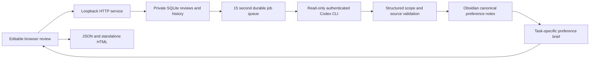

# Architecture

Browser anchors use paragraph identity, exact quote, UTF-16 offsets, snapshot and
surrounding context. CSS Highlight ranges leave editable text nodes untouched. After
an edit, unique exact matches or unique context matches can be relinked. Repeated or
missing matches are flagged. No approximate match is silently accepted.

The service uses SQLite WAL and expected-version checks. Each changed save stores
both the current document and an immutable version, then resets its job deadline.
Inference runs outside the store lock. Results from an older version are discarded.
Interrupted running jobs return to pending on service restart; failures retry after
60 seconds. Raw review persistence does not depend on inference success.

Codex runs with read-only sandboxing and an output schema. Editorial material is
delimited as untrusted data. Only the service writes preferences. Existing preference
records use a small JSON metadata comment inside readable Markdown. The private
database records hashes of generated files; a changed hash becomes a conflict note.
On first adoption, existing human-readable prose is preserved. Canonical notes, not
an external model state, determine subsequent preference briefs.

Scopes include general, academic, introduction, abstract, grant, report and
project:<ID>. Explicit rules may be active; inferred rules are candidates. Preference
identity is stable from scope and principle, and source IDs/round IDs are sets.
Known seeded rules are matched by source overlap within scope. This is provenance
deduplication, not a claim that arbitrary paraphrases can always be semantically merged.

Configuration and reviews live outside source control. The server never accepts a
write path from the browser, and no public publishing or external messaging endpoint
exists. Model-provider network traffic is handled by the installed Codex CLI.
