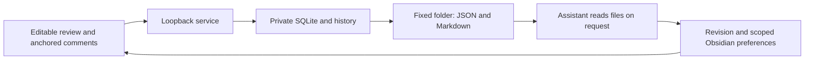

# Architecture

The default save path never calls a model. The user's chosen assistant reads
the files only when requested by the user. Background Codex extraction requires an
explicit --auto-extract startup flag; old queued jobs stay inactive otherwise.

CSS Highlight ranges use paragraph identity, exact quote, snapshot, UTF-16 offsets
and surrounding context. They do not wrap or replace editable nodes. Ambiguous anchors
are flagged instead of approximately relocated.

SQLite WAL, expected-version checks and browser recovery protect edits. The service
commits the review first, then writes immutable versioned JSON and Markdown into the
configured review folder. CURRENT.json is atomically updated after both files exist.
AI consumers should use this pointer, since latest files are convenience copies.
File export errors leave the database intact and retry locally. Startup backfills
existing reviews. Repeating a save does not add a history version.

Writable locations are the startup-configured data folder, review folder and the
vault's writing-memory subtree. Browser requests cannot change them. The private
API reports the review path, allowing the UI to copy an assistant-reading instruction.

Existing scoped preferences remain retrievable from canonical Markdown. Explicit
rules apply in scope; inferences remain candidates. The optional extraction adapter
retains source-ID/round deduplication and preserves human prose when appending provenance.
No model training or automatic scientific fact checking is performed.
